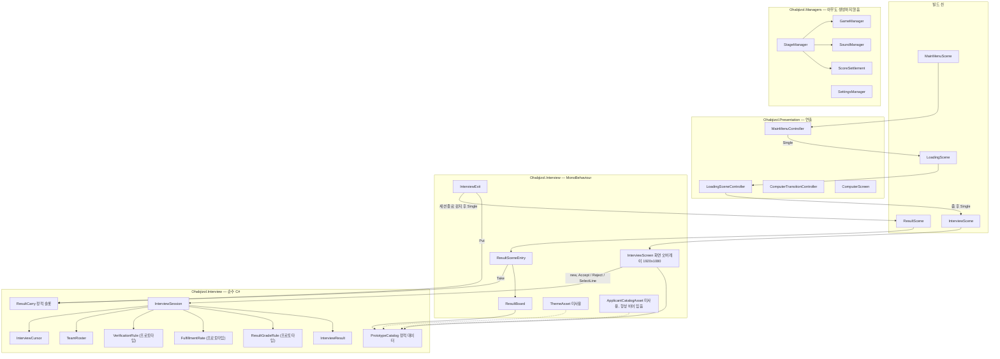
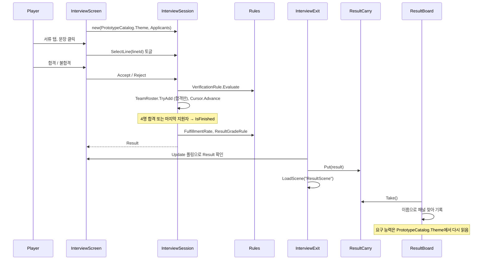

# 아키텍처 평가 — 면접 루프 추가 이후

평가 대상은 현재 작업 트리다. 이전 평가 이후 `Assets/Scripts/Interview`(28개 파일)와 `ResultScene`이 추가됐고, 빌드 순서는 메뉴 → 로딩 → 면접 → 결과다.

판정: 면접 규칙을 순수 C#으로 떼어 내고 UI가 세션만 호출하게 한 구조는 맞다. 다음 단계 전에 정리할 것은 세 가지다.

1. 세션 모델이 둘이다. 기존 `GameManager` / `StageManager` / `ScoreSettlement`는 아무도 쓰지 않는다. 그 옆에 `InterviewSession` / `InterviewResult` / `ResultCarry`가 같은 역할로 따로 생겼다. 어느 쪽이 권위인지 정해야 한다.
2. 데이터 소스가 `PrototypeCatalog` 하나로 굳어 있다. 화면과 결과판이 둘 다 그 정적 클래스를 직접 읽는다. `ThemeAsset`, `ApplicantCatalogAsset`은 연결되지 않은 껍데기다.
3. 규칙에 테스트가 없다. 등급, 충족률, 검증 판정이 이제 실제 게임 결과를 만든다.

## 현재 구조

`Ohabjizol.Interview`의 순수 쪽 파일은 `UnityEngine`을 참조하지 않는다. 다만 `InterviewScreen`, `ResultBoard` 같은 MonoBehaviour와 같은 네임스페이스, 같은 `Assembly-CSharp`에 있다. 지금은 폴더 이름(`Data`, `Rules`)만이 경계다.

## 면접 흐름

## 잘 된 것

- 규칙이 UI에서 분리됐다. `InterviewScreen`은 세션 메서드 세 개만 호출하고, 판정은 하지 않는다. 등급 수식은 `ResultGradeRule` 한 곳에만 있다.
- 표시 능력과 실제 능력이 `Applicant`와 `TeamRoster`에서 끝까지 분리돼 있다. 허위 지원자 메커니즘이 데이터 모델에 바로 드러난다.
- 도메인 객체가 불변이다. `SkillSet.Add`는 새 값을 만들고, `Applicant`와 `ApplicantDocument`는 생성 시 배열을 복사한다. 세션 바깥에서 팀을 바꿀 수 없다(`TeamRoster.TryAdd`는 `internal`).
- 프로토타입 규칙에 `PROTOTYPE ONLY` 표시가 일관되게 붙어 있어, 교체 대상이 grep 한 번으로 나온다.
- 씬 간 결과 전달이 `ResultCarry` 한 칸으로 좁혀져 있고, `Take`가 슬롯을 비운다.

## 위험과 수정 제안

심각도 순이다.

### 1. 세션 모델이 둘이다

`GameManager` / `StageManager`는 "세션 시작 → 스테이지 → `SettleScore` → 종료"를 위해 만들어졌지만 아무 씬도 생성하지 않는다. 면접 루프는 그것을 거치지 않고 자체 `InterviewSession`과 `InterviewResult`를 만들었다. `ScoreSettlement`(정수 점수 하나)와 `InterviewResult`(등급, 충족률, 검증 횟수)는 같은 자리를 노린다.

이대로 사운드나 설정을 붙이면, 누군가는 `StageManager`를 살려 BGM을 붙이고 다른 누군가는 `InterviewSession`에 이벤트를 추가하게 된다.

제안: `InterviewSession`을 게임 루프의 권위로 정한다. `GameManager`, `StageManager`, `StageContext`, `StageEvent`, `ScoreSettlement`는 두 번째 스테이지가 기획에 생길 때까지 삭제하거나 쓰지 않는다고 명시한다. `SoundManager`, `VfxManager`, `SettingsManager`, `WindowManager`는 오디오와 설정 화면이 생길 때 부트스트랩에서 쓰도록 남긴다. 사운드가 면접 이벤트에 반응해야 하면, `InterviewSession`이 아니라 `InterviewScreen` 쪽 어댑터가 세션 상태 변화를 보고 `SoundManager`를 호출한다.

### 2. 결과판이 테마를 다시 읽는다

`ResultBoard.Paint`는 요구 능력을 `PrototypeCatalog.Theme.RequiredSkills`에서 읽는다. 결과 객체가 아니라 정적 카탈로그다. 면접에서 다른 테마를 쓰게 되는 순간 결과 화면의 "요구 능력"이 틀린다. 등급은 실제 테마로 계산됐는데 화면은 다른 요구치를 보여 준다.

제안: `InterviewResult`에 `RequiredSkills`(또는 `GameJamTheme` 자체)를 넣고, `ResultBoard`는 결과만 읽는다. 결과 화면이 `PrototypeCatalog`를 참조하지 않게 한다.

### 3. 데이터 소스가 하드코드다

`InterviewScreen.Awake`는 `new InterviewSession(PrototypeCatalog.Theme, PrototypeCatalog.Applicants)`를 직접 호출한다. `ThemeAsset`은 비어 있으면 카탈로그로 떨어지는 구조지만, 씬에 에셋 인스턴스가 없고 어디서도 참조하지 않는다. `ApplicantCatalogAsset.IsEmpty`는 항상 `true`이고 `Resolve`는 항상 카탈로그를 돌려준다.

제안: `InterviewScreen`에 `[SerializeField] ThemeAsset`, `[SerializeField] ApplicantCatalogAsset`를 두고, 비어 있을 때만 카탈로그로 떨어지게 한다. 지원자 에셋을 실제로 작성할 계획이 없으면 두 에셋 클래스를 지우고 카탈로그만 남긴다. 쓰지 않는 추상화는 다음 작업자가 "이미 데이터 주도"라고 오해하게 만든다.

### 4. 규칙 테스트가 없다

`PrototypeCatalog`에는 설계 의도가 문자열 상수로 적혀 있다(`SituationA`: 2, 3, 1을 합격하면 그래픽 14/15이고 다음은 표시 18인 4번). 이 시나리오를 코드로 검증하는 곳이 없다. 등급 규칙이 기획 확정으로 교체될 때 회귀를 잡을 방법이 없다.

제안: `Ohabjizol.Interview.Core` asmdef(`noEngineReferences: true`)를 만들고 `Data`, `Rules`를 그 안으로 옮긴다. Edit Mode 테스트 어셈블리에서 다음을 고정한다.

- 시나리오 A, B, C 각각의 최종 등급과 충족률.
- 4명 합격 시 즉시 종료, 마지막 지원자 처리 후 종료, 지원자 0명 세션.
- 올바른 문장을 고른 경우와 다른 문장, 무선택 허위 지원자의 검증 결과.
- 종료 후 `Accept` / `Reject` / `SelectLine`이 상태를 바꾸지 않음.

`ResultCarry`는 씬 간 전달용이라 `Core`가 아니라 Unity 쪽 어셈블리에 둔다.

### 5. 결과판이 패널을 이름으로 찾는다

`ResultBoard.FindPanel`은 패널마다 씬 전체의 `Transform`을 `FindObjectsByType`으로 훑어 이름이 같은 것을 찾는다. 씬에서 패널 이름을 바꾸면 조용히 빈 칸이 된다. 같은 이름이 두 개면 먼저 찾은 것이 쓰인다.

제안: 패널 참조를 `[SerializeField]`로 받는다. 지금 패널은 `ResultScene`에 이미 배치돼 있으니 연결만 하면 된다.

### 6. 결과 씬이 막다른 길이다

`ResultScene`에서 메뉴로 돌아가거나 다시 시작하는 경로가 없다. `ResultSceneEntry`는 결과가 없으면 아무것도 하지 않고 반환한다. 에디터에서 결과 씬을 직접 열면 빈 화면이 나오고 원인을 알 수 없다.

`ResultCarry._result`는 `RuntimeInitializeOnLoadMethod`로 초기화되지 않는다. 지금 `EditorSettings`는 `m_EnterPlayModeOptions: 0`이라 플레이마다 도메인을 다시 불러오므로 문제가 드러나지 않는다. 팀이 빠른 플레이 진입을 위해 도메인 리로드를 끄면, `Put` 뒤 `Take` 전에 멈춘 결과가 다음 플레이에 남는다. `ComputerTransitionController`와 `LoadingSceneController`는 이미 이 초기화를 하고 있으니 같은 규칙을 맞춘다.

제안: `ResultCarry`에 `SubsystemRegistration` 초기화를 추가한다. 결과가 없을 때 경고를 남기거나 프로토타입 결과를 표시한다. 결과 화면에 메뉴로 돌아가는 버튼을 둔다.

### 7. 면접 종료가 보이지 않는다

`InterviewExit.Update`는 세션이 끝난 바로 다음 프레임에 결과 씬을 연다. `InterviewScreen`이 켜는 "면접 종료" 라벨은 한두 프레임만 보인다. 마지막 합격자가 팀 슬롯에 들어가는 것도 보이지 않는다.

`InterviewScreen.HandoffSceneName`은 화면이 다음 씬 이름을 아는 구조다. 주석은 "이 화면은 다른 씬을 열지 않는다"고 하지만, 씬 이름 상수는 화면에 있다.

제안: 씬 이름 상수를 `InterviewExit`로 옮기고, 종료 후 확인 버튼이나 짧은 유지 시간을 둔다. `Update` 폴링 대신 세션이 끝난 시점(`Accept` / `Reject` 직후)에 화면이 이벤트를 내면 된다.

### 8. 한글 폰트가 OS에 의존한다

`InterviewScreen`과 `ResultBoard`는 `Font.CreateDynamicFontFromOSFont("Malgun Gothic", "맑은 고딕", "Gulim")`을 쓴다. Windows 밖에서는 이 폰트가 없고, 폴백인 `LegacyRuntime.ttf`에는 한글 글리프가 없다. 화면이 빈 칸이 된다. 메뉴와 로딩은 영어라 영향이 없다.

제안: 한글 폰트를 프로젝트 에셋으로 넣고 직렬화로 참조한다. 두 클래스의 폰트 생성 코드를 하나로 합친다.

### 9. 면접 화면이 코드로만 만들어진다

`InterviewScreen.BuildOverlay`는 캔버스, 패널, 버튼 수십 개를 코드로 만든다. 메뉴와 로딩은 씬에 배치된 UI를 우선하고 코드 생성은 폴백이었는데, 면접 화면은 폴백만 있다. 결과 화면은 반대로 씬 배치를 쓴다. 디자이너가 면접 화면을 손대려면 C#을 고쳐야 한다.

이것은 프로토타입 단계에서는 허용할 만하다. 레이아웃 확정 전에 씬이나 프리팹으로 옮길지 결정만 해 두면 된다. 옮긴다면 결과 화면과 같은 방식(씬 배치 + 직렬화 참조)으로 맞춘다.

`_documentIndex`는 지원자가 바뀌어도 초기화되지 않는다. 이전 지원자에서 보던 서류 탭이 다음 지원자에게 그대로 열린다. 의도가 아니면 `Accept` / `Reject` 뒤에 0으로 돌린다.

### 10. 이전 평가에서 남은 것

- `LoadingSceneController.HandleInterviewLoaded`는 다음 씬의 `ComputerScreen`을 찾아 `ViewRoot`를 `Destroy`한다. 면접 씬에는 아직 스크린이 없어서 잠복 상태다. 면접 화면을 모니터 위 월드 UI로 옮기는 순간 카메라와 세트가 지워진다. 그 전에 제거한다.
- 로딩 캔버스는 `worldCanvasSize` 1700×1000인데 씬 저장값은 5000×3000이고, `PlaceOnScreen` 폴백에도 5000×3000이 하드코드돼 있다.
- asmdef가 하나도 없다. `Managers`, `Interview` 순수 규칙, 연출이 모두 `Assembly-CSharp`이다.
- PLAY 버튼은 `onClick`과 `Update` 마우스 검사 두 경로로 눌린다.

## 메인 AI에게 넘길 순서

1. `InterviewResult`에 요구 능력 포함, `ResultBoard`의 카탈로그 참조 제거, `ResultCarry` 초기화 추가. 작은 변경이고 결과 화면 정확성을 바로 고친다.
2. `Interview/Data`, `Interview/Rules`를 엔진 참조 없는 asmdef로 분리하고 Edit Mode 테스트로 시나리오 A, B, C를 고정한다. `ResultCarry`는 Unity 쪽으로 옮긴다.
3. 세션 모델을 하나로 정한다. `StageManager` 계열을 지우거나 "미사용"으로 문서화하고, `InterviewSession`이 권위라고 적는다.
4. `ThemeAsset` / `ApplicantCatalogAsset`을 `InterviewScreen`에 연결하거나 삭제한다.
5. `ResultBoard` 패널을 직렬화 참조로 바꾸고, 결과 화면에 메뉴 복귀를 둔다.
6. 한글 폰트 에셋을 넣는다.
7. 면접 화면을 모니터 위로 옮길 계획이 있다면, 그 전에 `HandleInterviewLoaded`의 `Destroy`를 지운다.

### 하지 말 것

- 등급이나 검증 규칙을 `InterviewScreen`이나 `ResultBoard`에 넣지 않는다. 규칙은 `Rules`에만 둔다.
- `ResultCarry`에 세션 전체나 지원자 목록을 넣지 않는다. 결과 화면은 `InterviewResult`만 받는다.
- `PROTOTYPE ONLY` 규칙을 기획 확정 전에 일반화하지 않는다. 테스트로 현재 동작을 고정한 뒤 교체한다.
- `InterviewSession`에 `SoundManager`나 `UnityEngine` 의존을 넣지 않는다.
