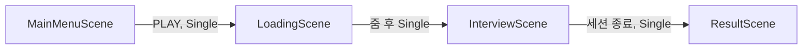
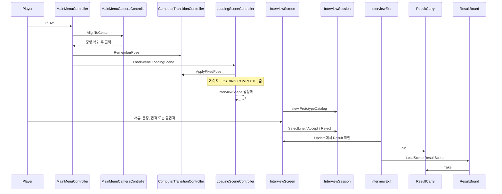
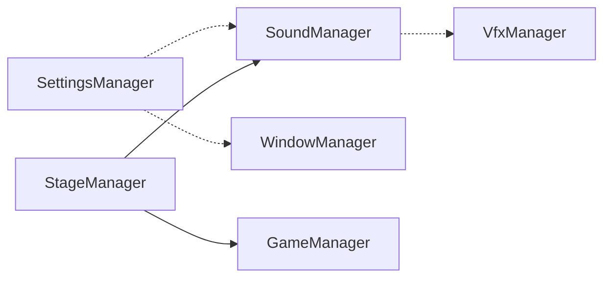

# 아키텍처

기준은 지금 작업 트리의 `Assets/Scripts`와 빌드 씬이다. asmdef는 없다. 전부 `Assembly-CSharp`다.

플레이되는 루프는 메뉴 → 로딩 → 면접 → 결과다. 그 루프의 권위는 `InterviewSession`이다. `Ohabjizol.Managers`는 순수 C#으로 남아 있으나 어떤 씬도 인스턴스를 만들지 않는다.

## 레이어

| 폴더 | 네임스페이스 | 엔진 | 플레이에서의 역할 |
| --- | --- | --- | --- |
| `Assets/Scripts/Interview/Data` | `Ohabjizol.Interview` | 없음 | 지원자, 서류, 능력, 테마, 프로토타입 카탈로그 |
| `Assets/Scripts/Interview/Rules` | `Ohabjizol.Interview` | 없음 | 세션, 검증, 충족률, 등급, 팀, 결과, 씬 간 슬롯 |
| `Assets/Scripts/Interview/UI` | `Ohabjizol.Interview` | Unity | 면접 오버레이, 결과 씬으로의 퇴장 |
| `Assets/Scripts/Interview/Result` | `Ohabjizol.Interview` | Unity | 결과 씬 진입과 패널 기록 |
| `Assets/Scripts/Interview/Unity` | `Ohabjizol.Interview` | Unity | 테마·지원자 ScriptableObject. 씬에 연결되지 않음 |
| `Assets/Scripts/Presentation` | `Ohabjizol.Presentation` | Unity | 메뉴, 카메라, 모니터, 로딩 |
| `Assets/Scripts/Managers` | `Ohabjizol.Managers` | 없음 | 세션·스테이지·사운드·설정. 플레이에서 생성되지 않음 |

프레젠테이션은 매니저를 참조하지 않는다. 면접은 매니저와 프레젠테이션을 참조하지 않는다. 폴더 이름이 지금 유일한 경계다. `Data`와 `Rules`는 `UnityEngine`을 쓰지 않지만, UI와 같은 어셈블리에 있다.

## 씬

빌드 순서는 `EditorBuildSettings` 기준이다. `SampleScene`은 꺼져 있다.

| 씬 | 붙은 스크립트 | 하는 일 |
| --- | --- | --- |
| `MainMenuScene` | `MainMenuController`, `MainMenuCameraController`, `ComputerScreen`, `ComputerTransitionController` | 모니터 위 PLAY. 마우스 드리프트를 중앙으로 되돌린 뒤 로딩을 연다 |
| `LoadingScene` | `LoadingSceneController`, `ComputerScreen`, `ComputerTransitionController` | 게이지, `LOADING COMPLETE`, 줌, 면접 씬 활성화 |
| `InterviewScene` | `InterviewScreen`, `InterviewExit` | 화면 오버레이로 면접. 컴퓨터 세트는 없다 |
| `ResultScene` | `ResultSceneEntry`, `ResultBoard` | 넘겨받은 결과를 색 패널에 기록. 메뉴로 돌아가는 경로는 없다 |

씬 전환은 전부 `LoadSceneMode.Single`이다. 이전 씬의 오브젝트는 로드와 함께 사라진다. 넘어가는 값은 두 칸뿐이다. 카메라 포즈는 `ComputerTransitionController`의 정적 필드, 면접 결과는 `ResultCarry`다.

## 플레이 흐름

### 메뉴

`MainMenuController.Awake`가 `onPlay`를 `AlignCenter`로 넣는다. `ComputerTransitionController`의 실행 순서는 50이라 그 뒤에 깨어나고, `onPlay`가 이미 있으면 `CenterAndLock`을 넣지 않는다. 그래서 지금 PLAY가 부르는 맞춤은 `MainMenuCameraController.AlignToCenter`다. 드리프트를 씬에 잡힌 기본 포즈로 되돌리고, 끝난 뒤에 룩을 잠근다. `CenterAndLock`은 같은 오브젝트에 남아 있으나 이 경로에서는 호출되지 않는다.

맞춤이 끝나면 `RememberPose`로 위치·회전·시야각을 남기고 `LoadingScene`을 연다. 이 클릭에는 줌이 없다.

PLAY는 `Button.onClick`과 `Update`의 마우스 사각형 검사가 둘이다. `_accepted`가 먼저 올라가서 씬은 한 번만 열린다.

### 로딩

`LoadingSceneController`는 저장된 포즈를 복원한다. 다시 중앙에 맞추지 않는다. `InterviewScene`을 `allowSceneActivation = false`로 비동기 로드하고, 게이지는 `AsyncOperation.progress`가 아니라 최소 시간과 표시 속도로 그린다. `LOADING COMPLETE`를 잠시 보여 준 뒤 `ComputerTransitionController.Begin`이 줌하고, 줌이 끝나면 면접 씬을 활성화한다.

활성화 직전에 `sceneLoaded`를 구독한다. 다음 씬에 `ComputerScreen`이 있으면 그 `ViewRoot`를 `Destroy`한다. 면접 씬에는 스크린이 없어서 지금은 실행되지 않는다. `ViewRoot`가 비어 있으면 `transform.root`까지 올라간다.

모니터 위 캔버스는 `ComputerScreen` 자식이다. 스크린 로컬 스케일이 월드 크기이고, 캔버스 로컬 스케일은 `1 / worldCanvasSize`라 단위 쿼드를 덮는다. 플레이 중 `preWillRenderCanvases`마다 `FitCanvas`가 `sizeDelta`를 `worldCanvasSize`로 다시 쓴다.

| | 메뉴 | 로딩 |
| --- | --- | --- |
| `worldCanvasSize` | 1600 × 900 | 1700 × 1000 |
| 씬에 저장된 루트 `sizeDelta` | 1600 × 900 | 5000 × 3000 |
| 스크린이 없을 때의 폴백 | 에러 로그만 | `LoadingSceneController`가 5000 × 3000을 하드코드 |

메뉴는 저장값과 필드가 같다. 로딩은 에디터 씬 뷰가 5000 × 3000을 보고, 플레이는 `FitCanvas`가 1700 × 1000으로 덮는다.

### 면접 화면

`InterviewScreen.Awake`가 `new InterviewSession(PrototypeCatalog.Theme, PrototypeCatalog.Applicants)`를 만들고, 1920 × 1080 기준의 스크린 스페이스 오버레이를 코드로 만든다. 씬에 배치된 위젯은 없다.

화면이 부르는 세션 메서드는 `SelectLine`, `Accept`, `Reject`뿐이다. 등급과 검증은 화면이 계산하지 않는다. 팀 슬롯과 합계는 표시 능력을 읽고, 요구 능력은 세션의 테마에서 읽는다.

세션이 끝나면 `Result`와 `HandoffSceneName`(`"ResultScene"`)이 값을 가진다. `InterviewExit.Update`가 그 다음 프레임에 `ResultCarry.Put` 후 씬을 연다. "면접 종료" 라벨은 그 한두 프레임만 보인다. 주석은 화면이 씬을 열지 않는다고 하고, 씬 이름 상수는 화면에 있다.

한글은 `Font.CreateDynamicFontFromOSFont("Malgun Gothic", "맑은 고딕", "Gulim")`이다. 없으면 `LegacyRuntime.ttf`로 떨어지며, 그 폰트에는 한글 글리프가 없다. 결과판도 같은 방식이다.

## 면접 도메인

한 네임스페이스 `Ohabjizol.Interview` 안에 데이터와 규칙이 같이 있다. 도메인 객체는 불변이다. `SkillSet.Add`는 새 값을 만들고, `Applicant`와 `ApplicantDocument`는 생성 시 배열을 복사한다. 팀을 바꾸는 입구는 `TeamRoster.TryAdd`뿐이고 `internal`이다.

### 사실

- `JobRole`: 기획, 프로그래밍, 그래픽.
- `SkillSet`: 세 능력의 정수. `Read`와 `Add`만 있다.
- `Applicant`: 이름, 주 직군, 표시 능력, 실제 능력, 서류 네 장, `ApplicantKind`(Normal, Fraud, Inappropriate). 표시와 실제가 갈라질 수 있다.
- `ApplicantDocument`: 종류 하나와 문장 두 줄. 종류는 지원서, 포트폴리오, 일정표, 면접 기록.
- `DocumentLine`: id, 문장, 그 문장이 올바른 의심인지.
- `GameJamTheme`: 표시 이름, 요구 능력, 핵심 직군.

### 세션

`InterviewSession`은 테마와 지원자 목록을 받아 한 판을 진행한다. 커서는 앞으로만 간다. 합격 네 명이 차거나, 처리한 지원자가 목록 끝이면 `IsFinished`다. 지원자가 0명이면 생성 즉시 끝난다. 끝난 뒤의 `Accept`, `Reject`, `SelectLine`은 상태를 바꾸지 않는다.

합격이면 검증을 누적하고 `TryAdd`한 뒤 커서를 진행한다. 불합격이면 팀에 넣지 않고 검증만 누적한 뒤 진행한다. 끝날 때 `BuildResult`가 실제 능력 합, 충족률, 검증 성공·실패, 허위 인원, 등급을 `InterviewResult`에 담는다. 결과 타입은 값을 들고만 있고 계산하지 않는다. 요구 능력은 결과에 들어 있지 않다.

### 프로토타입 규칙

`VerificationRule`, `FulfillmentRate`, `ResultGradeRule`, `PrototypeCatalog`, `SkillAnswerText`에 `PROTOTYPE ONLY`가 붙어 있다. 기획이 바뀌면 이 표시를 교체 지점으로 쓴다.

검증 (`VerificationRule.Evaluate`):

- 고른 문장이 올바른 의심이면 성공.
- 다른 문장을 골랐으면 실패.
- 아무것도 고르지 않았고 지원자가 허위면 실패.
- 그 외 무선택은 판정 없음.

충족률 (`FulfillmentRate.Percent`): 요구가 0보다 큰 능력만 본다. 능력마다 `actual / required`를 0에서 1로 자른 뒤 평균을 내고, 100을 곱해 반올림한다.

등급 (`ResultGradeRule.Evaluate`):

- 핵심 직군 실제 능력이 0이면 Fail.
- 세 능력 모두 요구 이상이고 허위가 0이면 S.
- 세 능력 모두 요구 이상이면 A.
- 핵심 직군이 요구 미만이면 C.
- 나머지는 B.

### 카탈로그

런타임 데이터는 `PrototypeCatalog` 정적 클래스 하나다.

- 테마는 "미연시". 요구는 기획 10, 프로그래밍 5, 그래픽 15. 핵심 직군은 그래픽.
- 지원자는 여섯 명이다. 1 김민수, 2 이서연, 3 박준호, 4 최하은, 5 정태식, 6 한소율.
- 최하은만 표시 그래픽 18, 실제 그래픽 7인 허위다. 올바른 의심 문장은 `4-portfolio-1` 하나다.
- 정태식은 `Inappropriate`다. 나머지는 `Normal`이고, 표시 능력과 실제 능력이 같다.

문자열 상수로 적힌 의도는 이렇다.

- 상황 A: 2, 3, 1을 합격하면 그래픽 14/15이고, 다음은 표시 18인 4번이다.
- 상황 B: 6번은 기획 7이라, 기획이 0인 팀에 필요하다.
- 상황 C: 4번의 그 한 줄만 올바른 의심이다.

이 시나리오를 단언하는 테스트는 없다.

`ThemeAsset.Resolve`는 이름이 비었거나 요구가 전부 0이면 카탈로그 테마를 돌려준다. `ApplicantCatalogAsset.Resolve`는 항상 카탈로그 지원자를 돌려주고 `IsEmpty`는 항상 참이다. 둘 다 씬과 `InterviewScreen`에서 참조되지 않는다.

### 결과 전달

`ResultCarry`는 정적 슬롯 하나다. `Put`은 null을 거절하고, `Take`는 슬롯을 비운다. `RuntimeInitializeOnLoadMethod`로 비우지 않는다. 도메인 리로드가 켜져 있으면 플레이마다 정적 상태가 사라진다. 도메인 리로드를 끄면 이전 플레이의 결과가 남을 수 있다. 카메라 포즈와 로딩 훅은 이미 `SubsystemRegistration`에서 초기화한다.

`ResultSceneEntry.Start`가 `Take`하고, 같은 오브젝트의 `ResultBoard.Show`를 부른다. 결과가 없으면 조용히 반환한다. 에디터에서 결과 씬만 열면 빈 화면이다.

`ResultBoard`는 실제 능력, 충족률, 검증, 허위, 등급을 결과에서 읽는다. 요구 능력만 `PrototypeCatalog.Theme.RequiredSkills`에서 다시 읽는다. 패널은 `FindObjectsByType`으로 씬 전체를 훑어 이름이 같은 `Transform`을 찾는다. 이름 목록은 `PlanningPanel`, `ProgrammingPanel`, `GraphicsPanel`, `FulfillmentPanel`, `VerificationSuccessPanel`, `VerificationFailurePanel`, `FraudPanel`, `GradePanel`이다.

## 매니저

`Assets/Scripts/Managers`는 `UnityEngine`이 없는 순수 C#이다. 부트스트랩이 없고, 프레젠테이션과 면접이 이 타입을 생성하지 않는다. 오디오 시계와 `Screen.SetResolution`은 이 폴더 밖에 두는 것이 이 레이어의 전제다.

실선은 생성자가 쥐는 관계다. 점선은 설계상 `Action`인데, 저장소 안에서 그 칸을 채우는 대입은 없다.

- `GameManager`: Idle → Running → Ended. 시작과 종료 이벤트만 있다. 심사 규칙은 없다.
- `StageManager`: 게임 중에 스테이지를 시작하고, BGM과 스테이지 사운드를 맡긴다. `SettleScore`는 호출자가 이미 계산한 `ScoreSettlement`(스테이지 id, 정수 점수, 요약)를 저장한다. 등급을 계산하지 않는다.
- `SettingsManager`: 볼륨, 해상도, 창 모드 선택을 저장하고 액션을 올린다. 오디오와 창을 적용하지 않는다.
- `SoundManager`: 사운드 인스턴스, BGM, 마스터 게이지. 시각 스폰은 `SpawnVfx` 액션에 맡긴다.
- `VfxManager`: `SoundObject.VfxId`로 시각을 스폰하고 멈춘다.
- `WindowManager`: 적용된 해상도와 창 모드를 기록하고 알린다. OS 변경은 하지 않는다.

`InterviewResult`(등급, 충족률, 검증 횟수, 허위 인원, 실제 능력)와 `ScoreSettlement`(정수 하나)는 같은 자리를 따로 갖고 있다. 지금 화면에 나오는 결과는 `InterviewResult`다.

## 지금 구조에서 어긋난 경계

코드를 고치라는 목록이 아니다. 다음 변경이 어느 층의 일인지 정할 때 쓰는 사실이다.

1. 세션 모델이 둘이다. 플레이는 `InterviewSession`만 쓴다. `GameManager`와 `StageManager`는 호출자가 없다.
2. 데이터 원천이 `PrototypeCatalog`다. `ThemeAsset`과 `ApplicantCatalogAsset`은 빈 껍데기이고, 결과판은 요구 능력을 결과가 아니라 카탈로그에서 다시 읽는다.
3. 규칙 테스트가 없다. 등급과 검증이 실제 결과 화면을 만든다.
4. 로딩 컨트롤러가 다음 씬의 `ViewRoot`를 지울 수 있다. 면접에 모니터를 복제하면 카메라와 세트가 사라진다.
5. 로딩 캔버스 크기가 두 벌이다. 필드 1700 × 1000, 씬과 폴백 5000 × 3000.
6. 메뉴 맞춤이 두 구현이다. 살아 있는 경로는 `AlignToCenter`이고, `CenterAndLock`은 `onPlay`가 비어 있을 때만 연결된다.
7. 면접 UI는 코드 생성, 결과 UI는 씬 배치다. 결과 패널은 직렬화 참조가 아니라 이름 검색이다.
8. 결과 씬은 막다른 길이다. `ResultCarry`는 도메인 리로드를 끄는 경우를 초기화하지 않는다.
9. 한글 폰트가 OS에 있다. 메뉴와 로딩 문구는 영어라 그 경로에는 영향이 없다.
