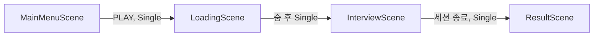

> 리팩토링 전 설계 기록. 현행 계약은 AI/리팩토링/00_책임분리_계약.md 참조.

## 씬

빌드 순서는 `EditorBuildSettings` 기준이다. `SampleScene`은 꺼져 있다.

| 씬 | 붙은 스크립트 | 하는 일 |
| --- | --- | --- |
| `MainMenuScene` | `MainMenuController`, `MainMenuCameraController`, `ComputerScreen`, `ComputerTransitionController` | 모니터 위 PLAY. 마우스 드리프트를 중앙으로 되돌린 뒤 로딩을 연다 |
| `LoadingScene` | `LoadingSceneController`, `ComputerScreen`, `ComputerTransitionController` | 게이지, `LOADING COMPLETE`, 줌, 면접 씬 활성화 |
| `InterviewScene` | `InterviewScreen`, `InterviewExit` | 화면 오버레이로 면접. 컴퓨터 세트는 없다 |
| `ResultScene` | `ResultSceneEntry`, `ResultBoard` | 넘겨받은 결과를 색 패널에 기록. 메뉴로 돌아가는 경로는 없다 |

씬 전환은 전부 `LoadSceneMode.Single`이다. 이전 씬의 오브젝트는 로드와 함께 사라진다. 넘어가는 값은 두 칸뿐이다. 카메라 포즈는 `ComputerTransitionController`의 정적 필드, 면접 결과는 `ResultCarry`다.

