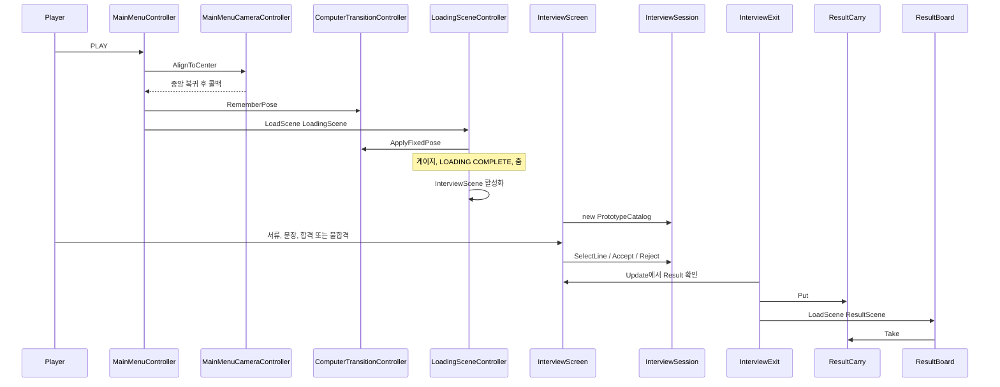

> 리팩토링 전 설계 기록. 현행 계약은 AI/리팩토링/00_책임분리_계약.md 참조.

## 플레이 흐름

### 메뉴

`MainMenuController.Awake`가 `onPlay`를 `AlignCenter`로 넣는다. `ComputerTransitionController`의 실행 순서는 50이라 그 뒤에 깨어나고, `onPlay`가 이미 있으면 `CenterAndLock`을 넣지 않는다. 그래서 지금 PLAY가 부르는 맞춤은 `MainMenuCameraController.AlignToCenter`다. 드리프트를 씬에 잡힌 기본 포즈로 되돌리고, 끝난 뒤에 룩을 잠근다. `CenterAndLock`은 같은 오브젝트에 남아 있으나 이 경로에서는 호출되지 않는다.

맞춤이 끝나면 `RememberPose`로 위치·회전·시야각을 남기고 `LoadingScene`을 연다. 이 클릭에는 줌이 없다.

PLAY는 `Button.onClick`과 `Update`의 마우스 사각형 검사가 둘이다. `_accepted`가 먼저 올라가서 씬은 한 번만 열린다.

### 로딩

`LoadingSceneController`는 저장된 포즈를 복원한다. 다시 중앙에 맞추지 않는다. `InterviewScene`을 `allowSceneActivation = false`로 비동기 로드하고, 게이지는 `AsyncOperation.progress`가 아니라 최소 시간과 표시 속도로 그린다. `LOADING COMPLETE`를 잠시 보여 준 뒤 `ComputerTransitionController.Begin`이 줌하고, 줌이 끝나면 면접 씬을 활성화한다.

활성화 직전에 `sceneLoaded`를 구독한다. 다음 씬에 `ComputerScreen`이 있으면 그 `ViewRoot`를 `Destroy`한다. 면접 씬에는 스크린이 없어서 지금은 실행되지 않는다. `ViewRoot`가 비어 있으면 `transform.root`까지 올라간다.

모니터 위 캔버스는 `ComputerScreen` 자식이다. 스크린 로컬 스케일이 월드 크기이고, 캔버스 로컬 스케일은 `1 / worldCanvasSize`라 단위 쿼드를 덮는다. 플레이 중 `preWillRenderCanvases`마다 `FitCanvas`가 `sizeDelta`를 `worldCanvasSize`로 다시 쓴다.

| | 메뉴 | 로딩 |
| --- | --- | --- |
| `worldCanvasSize` | 1600 × 900 | 1700 × 1000 |
| 씬에 저장된 루트 `sizeDelta` | 1600 × 900 | 5000 × 3000 |
| 스크린이 없을 때의 폴백 | 에러 로그만 | `LoadingSceneController`가 5000 × 3000을 하드코드 |

메뉴는 저장값과 필드가 같다. 로딩은 에디터 씬 뷰가 5000 × 3000을 보고, 플레이는 `FitCanvas`가 1700 × 1000으로 덮는다.

### 면접 화면

`InterviewScreen.Awake`가 `new InterviewSession(PrototypeCatalog.Theme, PrototypeCatalog.Applicants)`를 만들고, 1920 × 1080 기준의 스크린 스페이스 오버레이를 코드로 만든다. 씬에 배치된 위젯은 없다.

화면이 부르는 세션 메서드는 `SelectLine`, `Accept`, `Reject`뿐이다. 등급과 검증은 화면이 계산하지 않는다. 팀 슬롯과 합계는 표시 능력을 읽고, 요구 능력은 세션의 테마에서 읽는다.

세션이 끝나면 `Result`와 `HandoffSceneName`(`"ResultScene"`)이 값을 가진다. `InterviewExit.Update`가 그 다음 프레임에 `ResultCarry.Put` 후 씬을 연다. "면접 종료" 라벨은 그 한두 프레임만 보인다. 주석은 화면이 씬을 열지 않는다고 하고, 씬 이름 상수는 화면에 있다.

한글은 `Font.CreateDynamicFontFromOSFont("Malgun Gothic", "맑은 고딕", "Gulim")`이다. 없으면 `LegacyRuntime.ttf`로 떨어지며, 그 폰트에는 한글 글리프가 없다. 결과판도 같은 방식이다.

