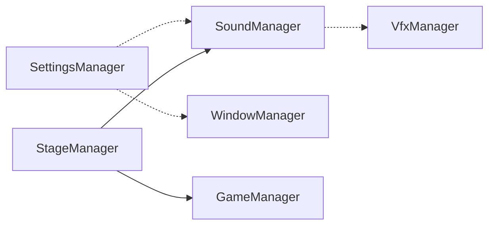

> 리팩토링 전 설계 기록. 현행 계약은 AI/리팩토링/00_책임분리_계약.md 참조.

## 매니저

`Assets/Scripts/Managers`는 `UnityEngine`이 없는 순수 C#이다. 부트스트랩이 없고, 프레젠테이션과 면접이 이 타입을 생성하지 않는다. 오디오 시계와 `Screen.SetResolution`은 이 폴더 밖에 두는 것이 이 레이어의 전제다.

실선은 생성자가 쥐는 관계다. 점선은 설계상 `Action`인데, 저장소 안에서 그 칸을 채우는 대입은 없다.

- `GameManager`: Idle → Running → Ended. 시작과 종료 이벤트만 있다. 심사 규칙은 없다.
- `StageManager`: 게임 중에 스테이지를 시작하고, BGM과 스테이지 사운드를 맡긴다. `SettleScore`는 호출자가 이미 계산한 `ScoreSettlement`(스테이지 id, 정수 점수, 요약)를 저장한다. 등급을 계산하지 않는다.
- `SettingsManager`: 볼륨, 해상도, 창 모드 선택을 저장하고 액션을 올린다. 오디오와 창을 적용하지 않는다.
- `SoundManager`: 사운드 인스턴스, BGM, 마스터 게이지. 시각 스폰은 `SpawnVfx` 액션에 맡긴다.
- `VfxManager`: `SoundObject.VfxId`로 시각을 스폰하고 멈춘다.
- `WindowManager`: 적용된 해상도와 창 모드를 기록하고 알린다. OS 변경은 하지 않는다.

`InterviewResult`(등급, 충족률, 검증 횟수, 허위 인원, 실제 능력)와 `ScoreSettlement`(정수 하나)는 같은 자리를 따로 갖고 있다. 지금 화면에 나오는 결과는 `InterviewResult`다.

