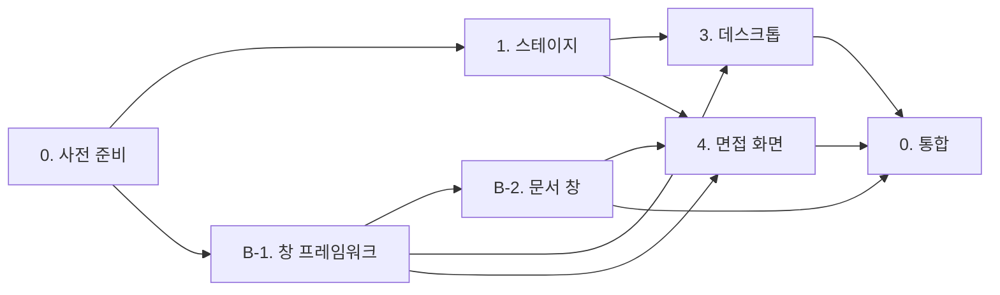

# 팀장 문서: 분배, 순서, 계약

기준 문서는 `AI/아키텍처.md`다. 이 문서는 세 요구(데스크톱 메인, 면접 화면 개편, 4스테이지 루프)를 누구에게 어떻게 나누는지 정한다. 각 에이전트는 자기 지침서와 이 문서의 "공용 계약"만 믿고 일한다.

## 인원

작업 에이전트 4명, 팀장 1명. 총 5.

| 번호 | 이름 | 맡는 요구 | 레이어 |
| --- | --- | --- | --- |
| A | 스테이지 (`A_스테이지.md`) | 요구 3 전체, 결과 씬 → 메인 복귀 | `Interview/Data`, `Interview/Rules`, `Interview/Stages`(신규), `Interview/Unity`, `Interview/Result` |
| B | 창 프레임워크 (`B_창_프레임워크.md`) | 요구 2의 창(툴바 → UI → 정보), 문서 창 4종 | `Assets/Scripts/UI`(신규, `Ohabjizol.UI`), `Interview/UI/Windows`(신규) |
| C | 데스크톱 (`C_데스크톱.md`) | 요구 1 전체 | `Presentation` |
| D | 면접 화면 (`D_면접_화면.md`) | 요구 2의 배경·작업표시줄·좌측 패널·합불 버튼·영상통화 참가자 | `Interview/UI`(Windows 제외), `Assets/Resources/Interview` |
| 0 | 팀장 | 계약 유지, 통합, 아키텍처 문서 갱신 | `AI/` |

더 쪼개지 않는 이유:

- `InterviewScreen.cs` 하나가 면접 화면 전체를 코드로 만든다. 둘이 같이 고치면 충돌만 난다. D번이 단독 소유한다.
- 메뉴와 로딩은 `ComputerTransitionController`의 정적 포즈와 `MainMenuController.Play` 경로를 공유한다. C번이 묶어서 가져간다.
- 창 프레임워크는 C번(설정·청강코드 창)과 D번(문서 창)이 모두 쓴다. 따로 떼어 B번이 먼저 내놓는다.

## 순서



- 1차: A번과 B-1을 동시에 돌린다. B-1은 작다. 먼저 끝낸다.
- 2차: B-2, C번, D번을 동시에 돌린다. A번이 아직이면 C·D번은 아래 "임시 대체"로 시작한다.
- 3차: 팀장이 통합 플레이 테스트를 하고 `AI/아키텍처.md`를 고친다.

### 임시 대체 (선행 작업이 안 끝났을 때)

- D번: `StageCatalog` 대신 `PrototypeCatalog.Theme`, `PrototypeCatalog.Applicants`로 세션을 만든다. 교체 지점에 `// STAGE-HOOK` 주석을 단다.
- C번: `StageProgressStore` 대신 "입학 게임잼" 고정 문자열을 쓴다. 교체 지점에 `// STAGE-HOOK`.
- C·D번: 창 프레임워크가 없으면 착수하지 않는다. B-1을 기다린다.

## 사전 준비 (팀장 또는 사용자)

1. 지금 작업 트리를 커밋한다. `Assets/Scripts/Interview` 전체가 아직 untracked라 워크트리나 브랜치를 따면 사라진다.
2. `Assets/_Recovery/0.unity`는 Unity 크래시 복구 씬이다. 필요 없으면 지운다.
3. 에이전트는 같은 작업 트리에서 일한다. Unity 워크트리는 `Library` 재임포트가 무겁다. 대신 아래 "파일 소유권"을 어기지 않는다.

## 파일 소유권

남의 파일을 고쳐야 하면 고치지 말고 팀장에게 요청을 남긴다(지침서 끝의 "보고" 형식).

| 경로 | 소유 |
| --- | --- |
| `Assets/Scripts/Interview/Data/**` | 1 |
| `Assets/Scripts/Interview/Rules/**` | 1 |
| `Assets/Scripts/Interview/Stages/**` (신규) | 1 |
| `Assets/Scripts/Interview/Unity/**` | 1 |
| `Assets/Scripts/Interview/Result/**`, `Assets/Scenes/ResultScene.unity` | 1 |
| `Assets/Scripts/UI/**` (신규) | 2 |
| `Assets/Scripts/Interview/UI/Windows/**` (신규) | 2 |
| `Assets/Scripts/Presentation/**`, `MainMenuScene.unity`, `LoadingScene.unity` | 3 |
| `Assets/Scripts/Interview/UI/*.cs` (Windows 제외), `InterviewScene.unity` | 4 |
| `Assets/Resources/Interview/**` (신규) | 4 |
| `Assets/Scripts/Managers/**` | 읽기 전용. C번만 `SettingsManager`를 생성해 쓸 수 있다. 수정 금지 |
| `ProjectSettings/**`, `AI/**` | 0 |

씬 YAML은 되도록 손대지 않는다. 지금 관례대로 UI는 코드로 만들고, 씬에는 컴포넌트만 붙어 있다.

## 공용 계약

시그니처는 확정이다. 바꾸려면 팀장 승인을 받는다. 구현 세부는 각자 자유.

### 스테이지 (A번이 제공)

```csharp
namespace Ohabjizol.Interview   // Assets/Scripts/Interview/Stages, UnityEngine 금지
{
    public enum StageId { EntranceGameJam = 0, GameProgrammingIntro = 1, SecondYear = 2, ThirdYear = 3 }

    public sealed class StageDefinition
    {
        public StageId Id { get; }
        public string DisplayName { get; }          // "입학 게임잼", "겜프입 프로젝트", "2학년 프로젝트", "3학년 프로젝트"
        public GameJamTheme Theme { get; }
        public IReadOnlyList<Applicant> Applicants { get; }
    }

    public static class StageCatalog
    {
        public static IReadOnlyList<StageDefinition> All { get; }   // StageId 순서
        public static StageDefinition Get(StageId id);
    }

    public static class StageAccuracyRule
    {
        public const int ClearPercent = 70;
        public static int Percent(SkillSet actual, SkillSet required);
        public static bool IsClear(int percent);                    // percent >= ClearPercent
    }

    public sealed class StageProgress
    {
        public bool IsCleared(StageId id);
        public int BestAccuracy(StageId id);        // 기록 없으면 -1
        public bool IsPlayable(StageId id);         // 첫 스테이지이거나 직전 스테이지 클리어
        public StageId NextStage { get; }           // 첫 미클리어. 전부 클리어면 ThirdYear
        public bool AllCleared { get; }
        public void Record(StageId id, int accuracyPercent);   // 최고 기록 갱신. 한 번 클리어는 유지
    }
}

namespace Ohabjizol.Interview   // Assets/Scripts/Interview/Unity
{
    public static class StageProgressStore    // PlayerPrefs
    {
        public static StageProgress Load();
        public static void Save(StageProgress progress);
        public static void ResetAll();
    }

    public static class StageSelection        // 메뉴 → 면접으로 넘기는 정적 슬롯
    {
        public static bool HasValue { get; }
        public static StageId Current { get; }    // 값이 없으면 StageProgressStore.Load().NextStage
        public static void Set(StageId id);
    }
}
```

`InterviewSession`과 `InterviewResult`에 추가되는 것:

```csharp
public InterviewSession(StageDefinition stage);   // 기존 생성자는 유지, Stage = EntranceGameJam
public StageId Stage { get; }

// InterviewResult
public StageId Stage { get; }
public SkillSet RequiredSkills { get; }
public int AccuracyPercent { get; }
public bool IsCleared { get; }
```

### 클리어 판정

요구: "실제 능력치와 요구 능력치 차이의 백분율이 0에 가까워 70% 이상의 정확도".

```
대상      = 요구가 0보다 큰 능력
오차_i    = min(|실제_i − 요구_i| / 요구_i, 1)
정확도    = round(100 × (1 − 평균(오차_i)))     // MidpointRounding.AwayFromZero
대상 없음 = 100
클리어    = 정확도 >= 70
```

- 모자라도, 넘쳐도 감점이다. 기존 `FulfillmentRate`(넘치면 1로 자름)와 다르다. 둘 다 남긴다.
- 실제 능력(`ActualSkills`)으로 판정한다. 화면의 표시 능력이 아니다. 허위 지원자를 거르지 못하면 정확도가 떨어진다.
- 예: 요구 10/5/15, 실제 12/5/12 → 오차 0.2, 0, 0.2 → 정확도 87 → 클리어.
- 기존 등급(S/A/B/C/Fail)은 결과판에 그대로 보여 준다. 클리어 여부는 등급과 무관하다.

### 스테이지 흐름

```mermaid
flowchart LR
  Desk[MainMenuScene 데스크톱] -->|"청강코드 더블클릭, StageSelection.Set(NextStage)"| Load[LoadingScene]
  Load --> Interview[InterviewScene, StageCatalog.Get(StageSelection.Current)]
  Interview --> Result[ResultScene, Record + Save]
  Result -->|"메인으로"| Desk
```

- 실패하면 같은 스테이지가 다시 `NextStage`다.
- 네 스테이지를 모두 클리어한 뒤 청강코드를 열면 마지막 스테이지를 다시 한다. 엔딩은 범위 밖이다.

### 창 프레임워크 (B번이 제공)

```csharp
namespace Ohabjizol.UI   // Assets/Scripts/UI. 게임 네임스페이스를 참조하지 않는다
{
    public static class UiKit
    {
        public static Font Font { get; }           // 맑은 고딕 → 굴림 → LegacyRuntime
        public static Sprite White { get; }
        public static Text Text(Transform parent, string name, int size, FontStyle style, TextAnchor align);
        public static Image Image(Transform parent, string name, Color color);
        public static Button Button(Transform parent, string name, string caption, Color color, int size);
        public static void Place(RectTransform rect, float minX, float minY, float maxX, float maxY);
        public static void Stretch(RectTransform rect, float padding);
        public static void EnsureEventSystem();
    }

    // 창 = 툴바(드래그, 제목) → UI(툴바 오른쪽, 닫기) → 정보(툴바 아래)
    public class WindowToolbar : MonoBehaviour
    {
        public RectTransform Root { get; }
        public RectTransform Toolbar { get; }
        public RectTransform Controls { get; }
        public RectTransform Info { get; }
        public string Title { get; set; }
        public bool IsOpen { get; }
        public event Action<WindowToolbar> Opened;
        public event Action<WindowToolbar> Closed;

        public void Build(RectTransform parent, string title, Vector2 size, Vector2 anchoredPosition);
        public void Open();
        public void Close();
        public void Toggle();
        public void BringToFront();
        protected virtual void OnBuilt() { }
        protected virtual void OnOpened() { }
    }

    public abstract class InfoWindow : WindowToolbar
    {
        protected abstract void BuildInfo(RectTransform info);   // 정보 영역 구현은 자유
        public virtual void Refresh() { }
    }

    public static class WindowFactory
    {
        public static T Create<T>(RectTransform parent, string title, Vector2 size, Vector2 anchoredPosition)
            where T : WindowToolbar;
    }
}
```

문서 창 (B번이 제공, D번이 사용):

```csharp
namespace Ohabjizol.Interview   // Assets/Scripts/Interview/UI/Windows
{
    public sealed class DocumentWindow : InfoWindow
    {
        public DocumentKind Kind { get; }
        public void Bind(InterviewSession session, DocumentKind kind, Action changed);
        public override void Refresh();
    }

    public static class DocumentKindText
    {
        public static string Korean(DocumentKind kind);
        public static Color Color(DocumentKind kind);
    }
}
```

## 공용 규칙

- 네임스페이스와 폴더는 위 표를 따른다. `Data`, `Rules`, `Stages`에 `UnityEngine`을 쓰지 않는다.
- 한글이 보이는 모든 텍스트는 `UiKit.Font`를 쓴다. 메뉴는 지금 `LegacyRuntime.ttf`라 한글이 깨진다.
- 프로토타입 값에는 기존처럼 `PROTOTYPE ONLY`를 붙인다.
- 주석은 코드가 보여 주지 못하는 제약만 쓴다. 기존 파일의 XML 요약 주석 밀도를 따른다.
- 컴파일 확인: Unity 에디터는 사용자가 열어 둔다. 에이전트는 배치 모드로 Unity를 띄우지 않는다. 저장 후 `%LOCALAPPDATA%\Unity\Editor\Editor.log`에서 `error CS`를 찾는다. 로그가 갱신되지 않으면 사용자에게 에디터 포커스를 요청한다.
- UI 위치 미세조정을 같은 요소로 세 번 넘게 반복하게 되면 멈추고 사용자에게 인스펙터 조정을 요청한다. D번 지침서의 `InterviewLayout` 방식을 C번도 따른다.

## 보고 형식

각 에이전트는 끝날 때 이 형식으로 남긴다.

```
## 에이전트 N 보고
- 만든/고친 파일:
- 계약 변경 요청: (없으면 없음)
- 남의 파일에 필요한 수정: (경로, 이유)
- 사용자에게 필요한 일: (에셋, 위치 조정, 플레이 확인)
- 확인한 것 / 확인 못 한 것:
```

## 통합 체크리스트 (팀장)

- [ ] `Editor.log`에 `error CS` 없음
- [ ] 데스크톱: 아이콘 한 번 클릭은 선택만, 더블클릭은 실행. 아이콘은 끌리지 않는다
- [ ] 청강코드: 창 등장 → 로딩 → `LOADING COMPLETE`에 해당하는 문구 → 줌 → 면접 씬
- [ ] 설정: 볼륨이 바로 들린다. 해상도·창 모드가 빌드에서 바뀐다. 컴퓨터 종료가 플레이를 끝낸다
- [ ] 튜토리얼: 아이콘과 버튼이 있고 아무 것도 망가뜨리지 않는다
- [ ] 면접: Discord 배경, 하단 작업표시줄, 문서 창 4종 열기·닫기·드래그, 좌측 자리·요구·현재, 우하단 합격·불합격
- [ ] 영상통화: 현재 지원자가 큰 화면, 합격자가 작은 타일. idle/talk가 1초마다 바뀐다
- [ ] 결과: 정확도, 클리어 여부, 메인으로 버튼
- [ ] 메인 복귀 후 다음 스테이지가 표시된다. 실패하면 같은 스테이지
- [ ] 플레이를 껐다 켜도 클리어 기록이 남는다. 설정의 진행 초기화로 지워진다
- [ ] 네 스테이지 모두 70% 이상이 가능한 조합이 하나 이상 있다
- [ ] `AI/아키텍처.md`의 레이어 표, 씬 표, 플레이 흐름, "어긋난 경계" 8번(결과 씬 막다른 길)을 갱신
