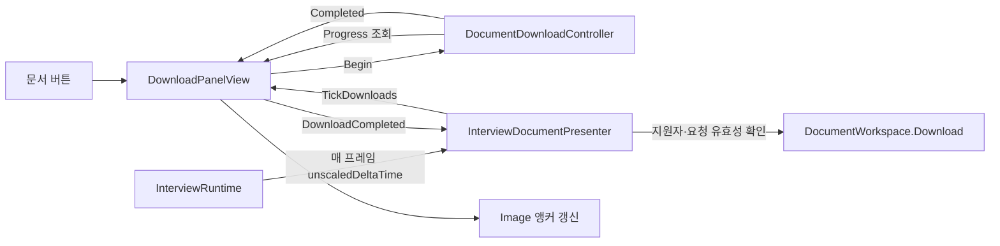

# 구조와 동작

## 근거 파일

이하 약칭과 행 번호로 실제 코드 위치 표기함.

- View: [DownloadPanelView.cs](../../../Assets/Scripts/Interview/UI/DownloadPanelView.cs)
- Controller: [DocumentDownloadController.cs](../../../Assets/Scripts/Interview/Runtime/DocumentDownloadController.cs)
- Presenter: [InterviewDocumentPresenter.cs](../../../Assets/Scripts/Interview/Runtime/InterviewDocumentPresenter.cs)
- Runtime: [InterviewRuntime.cs](../../../Assets/Scripts/Interview/Runtime/InterviewRuntime.cs)
- Applicant: [InterviewApplicantPresenter.cs](../../../Assets/Scripts/Interview/Runtime/InterviewApplicantPresenter.cs)
- Screen: [InterviewScreen.cs](../../../Assets/Scripts/Interview/UI/InterviewScreen.cs)
- Stage: [StageManager.cs](../../../Assets/Scripts/Interview/Runtime/StageManager.cs)
- Request: [DocumentDownloadRequest.cs](../../../Assets/Scripts/Interview/Data/DocumentDownloadRequest.cs)
- Kind: [DocumentKind.cs](../../../Assets/Scripts/Interview/Data/DocumentKind.cs)
- Authoring: [InterviewScreen.Authoring.cs](../../../Assets/Scripts/Interview/UI/InterviewScreen.Authoring.cs)

## 역할과 객체 관계

- View: 버튼 입력·진행률 표시·패널 슬라이드·완료 이벤트 중계 담당함. readonly Controller를 직접 생성·소유함(View 9–22, 31–67, 76–123행).
- Controller: 문서별 작업 2개, 지원자 키, generation, 소요시간·진행률·완료 상태 관리함. Unity UI 의존 없음(Controller 1–24, 49–73행).
- Presenter: 패널과 DocumentWorkspace 연결, 지원자 바인딩, 유효 완료의 workspace 전달 담당함(Presenter 7–56행).
- Runtime: Presenter 구성과 Stage 이벤트 연결, Screen 코루틴을 통한 Tick·활성 수명 관리 담당함(Runtime 27–50, 70–143행).
- Request는 ApplicantKey·Generation·Kind를 보관함. 일정·문서 상태의 전체 소유권을 View로 옮긴 구조가 아님(Request 3–14행, Presenter 30–56행).

## Lifecycle

- Awake: 필수 패널·버튼 참조 누락 시 오류 후 enabled=false·반환함. 정상 시 Controller 완료와 버튼 3개의 리스너 연결함(View 70, 76–83행).
- OnEnable: 진행률만 다시 그림. OnDisable: CloseImmediate로 슬라이드 중단·닫힌 위치 적용함. 다운로드 취소·구독 해제 없음(View 92–103행).
- OnDestroy: 대기 요청 취소, Controller 완료 구독 해제, 버튼 리스너 제거함(View 84–91행).
- 리스너는 Awake→OnDestroy 수명임. 활성화 반복에 의한 중복 등록 구조 아님(View 79–93행).
- Screen.OnDisable→Runtime.Disable: Tick 코루틴 중단, Presenter.Suspend 후 Unsubscribe 실행함. Unsubscribe가 CancelPending과 완료 구독 해제 수행함(Screen 130–134행, Runtime 102–123행, Presenter 23–28, 41행).
- Screen.OnDestroy→Runtime.Dispose: Disable·지원자 Clear·Presenter.Dispose로 정리함(Screen 136–140행, Runtime 125–134행, Presenter 50행).

## 입력→Tick→진행률→완료

1. 버튼→RequestApplication/RequestPortfolio→BeginDownload 호출함. 활성·사용 상태에서 0.2–1초 범위로 보정한 임의 소요시간 전달함(View 60–66, 80–81, 94–95행).
2. Controller.Begin은 키가 없거나 해당 종류가 진행 중·이미 완료면 무시함. 같은 컨텍스트에서 재클릭으로 중복 작업을 만들지 않음(Controller 49–57행).
3. Runtime.Enable에서 Screen 코루틴 시작함. 매 프레임 Time.unscaledDeltaTime→Presenter→View→Controller.Tick으로 전달함(Runtime 84–85, 136–143행, Presenter 38행, View 34행).
4. Tick은 음수 delta를 0으로 보정하고 진행률을 최대 1까지 계산함. View는 Image의 가로 anchorMax를 진행률로 바꿈. fillAmount 방식 아님(Controller 59–68행, View 36–58행).
5. 완료 시 Request를 먼저 비우고 Completed=true 설정 후 현재 요청일 때만 Completed 발생함. 후속 Tick이 같은 작업 완료를 반복 발생시키지 않음(Controller 69–72행).
6. View.DownloadCompleted→Presenter가 지원자 존재·IsCurrent·지원자 키 일치 검사→workspace.Download(kind) 호출함(View 42–44행, Presenter 52–56행).
7. View는 신규 이벤트 반환 후 IsCurrent 재검사하여 ApplicationRequested 또는 PortfolioRequested 전달함. 조사 범위에서 두 기존 이벤트의 외부 구독자 없음(View 45–47, 68–69행, 검색 기록).

- 실제 HTTP·파일 IO 구현은 확인한 View·Controller에 없음. 여기서 다운로드는 소요시간 기반 작업 상태와 완료 요청 전달임.
- 버튼 interactable을 진행 중에 변경하지 않음. Controller가 중복 시작을 막으므로 이를 확정 버그로 볼 근거 없음(View 60–67행, Controller 53행).
- 완료 이벤트 실행 중 컨텍스트가 바뀌면 Controller는 generation 변화 시 나머지 작업 순회를 중단함. View도 기존 이벤트 직전 다시 검사함(Controller 61–64행, View 45행).
