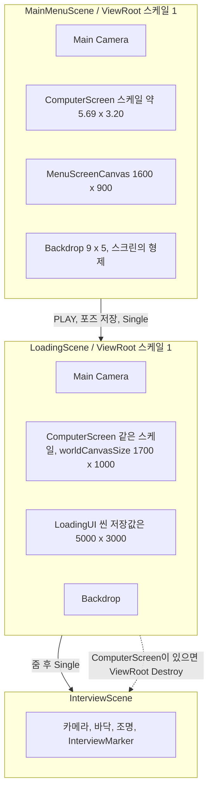
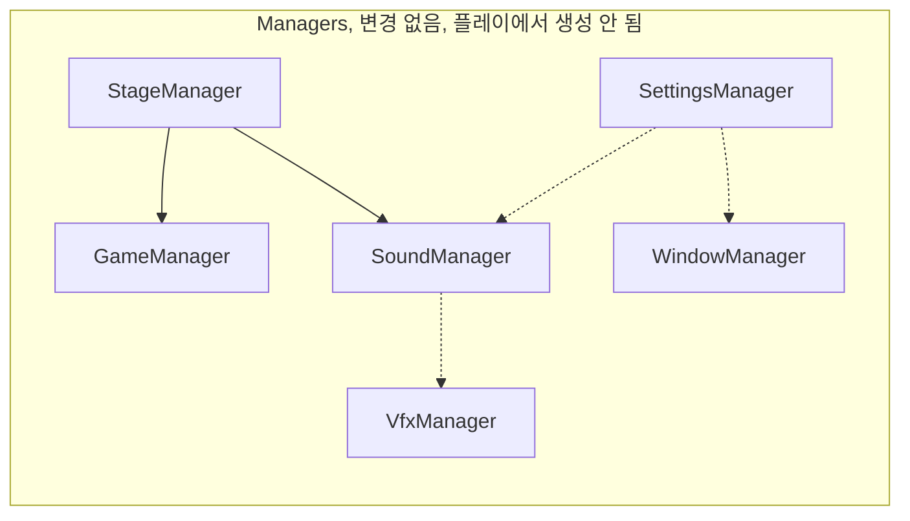
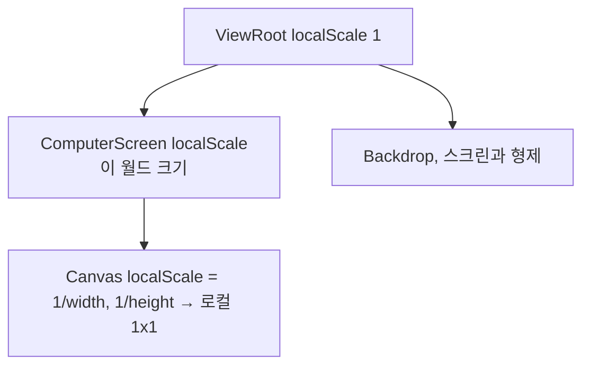

# 아키텍처 평가

평가 대상은 지금 작업 트리다. 매니저 레이어는 이전과 같고, 바뀐 곳은 모니터와 캔버스다.

판정: 씬 분리와 모니터 로컬 스케일 방향은 맞다. 로딩 캔버스 수치가 두 벌이라 에디터와 플레이가 다른 UI를 본다. 면접 씬에 컴퓨터 세트를 넣기 전에 `ViewRoot` 파괴부터 빼라. 매니저 조립은 이번 연출 수정과 섞지 마라.

## 이번 구조에서 맞은 것

메뉴와 로딩은 각자 `ViewRoot`를 가진다. PLAY는 카메라를 `DontDestroyOnLoad`로 넘기지 않고, 포즈만 정적 필드에 남긴 뒤 `LoadSceneMode.Single`로 로딩 씬을 연다. 줌은 로딩 씬이 게이지를 끝낸 뒤에만 한다. 메뉴에 붙은 `ComputerTransitionController`는 여전히 재생 경로가 아니다.

모니터의 월드 크기는 `ComputerScreen` 로컬 스케일이다. 두 씬 모두 약 `5.686 x 3.198`이고, 비율은 16:9다. `ViewRoot` 스케일은 1이다. 배경 `Backdrop`은 형제이고 `9 x 5 x 0.2`라 스크린보다 크다. 캔버스는 스크린의 자식이다. 로컬에서 1x1 쿼드를 덮으므로 UI가 배경으로 넘어가지 않는다.

메뉴는 이 규칙과 숫자가 일치한다.

| 항목 | 메뉴 | 로딩 |
| --- | --- | --- |
| `worldCanvasSize` | 1600 x 900 | 1700 x 1000 |
| 씬에 저장된 캔버스 `sizeDelta` | 1600 x 900 | 5000 x 3000 |
| 씬에 저장된 캔버스 스케일 | 1/1600, 1/900 | 1/5000, 1/3000 |
| 위젯 배치 | 그 크기에 맞음 | 너비 약 1580, 글자 150. 1700 x 1000에 맞음 |
| `updateRectTransformForStandalone` | Disabled | Disabled |

`Assets/Scripts/Editor`는 디스크에 없다. 로딩 씬을 에디터 기동 때 다시 저장하는 스크립트는 현재 실행 경로에 없다.

`Ohabjizol.Presentation`은 여전히 `Ohabjizol.Managers`를 참조하지 않는다. 매니저 파일은 그대로다.

## 현재 구조

캔버스가 쿼드를 덮는 방식은 이렇다.

플레이 중 `ComputerScreen.FitCanvas`가 `preWillRenderCanvases`마다 루트 캔버스를 스크린 자식으로 다시 맞추고, `sizeDelta`를 `worldCanvasSize`로 덮어쓴다. 그래서 로딩 씬의 5000 x 3000은 플레이에서 1700 x 1000이 된다. 에디터 씬 뷰는 저장값을 그대로 보여 준다.

## 남은 위험

### 1. 로딩 캔버스의 원천이 두 개다

플레이는 `worldCanvasSize` 1700 x 1000을 쓴다. 씬 파일의 `LoadingUI`는 5000 x 3000, 스케일 1/5000, 1/3000이다. 자식 좌표와 글자 크기는 1700 쪽에 가깝다. 에디터에서 보면 UI가 쿼드 가운데 작게 있고, 플레이에서 `FitCanvas`가 키운다.

`LoadingSceneController.PlaceOnScreen`은 `ComputerScreen`이 없을 때 아직 5000 x 3000을 하드코드한다. `CreateDefaultUi`의 좌표는 그 크기와 맞지 않는다.

맞출 것: `LoadingUI`의 `sizeDelta`와 스케일을 1700 x 1000, `1/1700`, `1/1000`으로 씬에 저장한다. 폴백의 5000 x 3000을 지운다. 메뉴 1600 x 900과 로딩 1700 x 1000을 한 숫자로 합치려면 위젯 좌표를 같이 옮긴다. 숫자만 복사하지 않는다.

`FitCanvas`는 그 저장값을 매 프레임 다시 쓴다. 루트 캔버스 스케일을 애니메이션하거나 씬에서만 미세 조정하면 플레이에서 사라진다. 크기 변경은 `worldCanvasSize` 한 곳으로 모은다.

### 2. 면접 씬에 컴퓨터를 넣으면 세트가 지워진다

`LoadingSceneController.HandleInterviewLoaded`가 다음 씬의 `ComputerScreen`을 찾아 `ViewRoot`를 `Destroy`한다. 로드는 `Single`이라 로딩 씬은 이미 빠진다. 면접 씬에는 스크린이 없어서 지금은 아무 일도 없다.

`ViewRoot` 아래에는 카메라, 스크린, 배경, 라이트가 있다. 지금 구조를 면접에 복제하는 순간 그 세트가 사라진다. `viewRoot`가 비면 `transform.root`까지 지운다.

컴퓨터를 면접 씬에 두기 전에 이 `Destroy`와 `sceneLoaded` 구독을 제거한다.

### 3. 매니저 경계는 그대로다

아래는 이번 연출 수정으로 해결되지 않았다. 연출 수치를 고치는 변경에 넣지 않는다.

- 매니저를 만드는 부트스트랩이 없다. `SettingsManager`의 `Action`과 `SoundManager.SpawnVfx`는 연결되지 않는다.
- asmdef가 없다. `Managers`에 `UnityEngine`을 넣는 순간 경계가 컴파일러에 안 걸린다.
- `StartGame` / `EndStage` 콜백 안의 재진입을 거절하지 않는다. 구독자는 콜백이 반환된 뒤에 다음 전환을 호출한다.
- `StageManager`는 심사 규칙을 갖지 않는다. 규칙은 면접 쪽 새 타입이 `RaiseStageEvent`와 `SettleScore`로만 연결한다.
- 오디오 시계와 `Screen.SetResolution`은 어댑터다. 매니저 안으로 넣지 않는다.
- `WindowManager.ApplyResolution`은 `default(Resolution)`인 0 x 0을 거부하지 않는다.
- Edit Mode 테스트가 없다.
- PLAY는 `Button.onClick`과 `Update`의 마우스 검사가 둘이다. `_accepted`가 씬을 두 번 열지는 않는다.

`ComputerScreen.Awake`는 여전히 렌더러 `sharedMaterial`을 런타임 머티리얼로 바꾼다. 셰이더 선택 순서는 맞다. 이미 있는 머티리얼의 이름에 `Unlit`이 있으면 그걸 쓰고, 없을 때만 `Shader.Find`로 떨어진다. 씬 머티리얼이 Unlit을 직접 참조하면 빌드 스트립을 피한다.

## 메인 AI가 다음에 할 일

1. `HandleInterviewLoaded`의 `Destroy`를 제거한다.
2. 로딩 캔버스 저장값을 `worldCanvasSize` 1700 x 1000과 같게 하고, 5000 x 3000 폴백을 삭제한다.
3. 그 다음에야 면접 씬에 컴퓨터 세트를 복제한다. 복제해도 `ViewRoot`를 지우지 않는다.
4. 매니저 부트스트랩, asmdef, 심사 루프는 별도 변경으로 둔다. 메뉴 컨트롤러에서 매니저를 호출하지 않는다.
