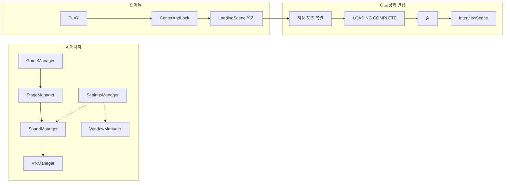

---
cursor:
  subagentId: "bc-8d97949e-2e52-5e8d-853c-eea32f4e2cc1"
---

# 구조 도면

기준은 지금 트리와 `AI 제안/아키텍처.md`다. 이 문서는 책임 경계와 틈만 그린다. 구역을 누구에게 줄지, 수정을 언제 시작할지는 여기 없다.

매니저는 순수 C#이다. 메뉴·로딩·면접은 `Ohabjizol.Presentation`이다. 프레젠테이션은 매니저를 참조하지 않는다.

요청된 흐름은 이렇다. PLAY는 등록된 액션으로 카메라를 화면 중앙에 맞추고 고정한 뒤 `LoadingScene`을 연다. 그 액션에는 줌이 없다. 로딩이 끝나면 `LOADING COMPLETE`를 보여주고, 그 다음 줌하고, 그 다음 `InterviewScene`을 연다. 로딩 끝에서 다시 중앙에 맞추지 않는다.

아래 A, B, C는 파일 쓰기가 겹치지 않는 책임 절단이다. 배분은 메인 쪽이 한다.

점선은 설계상 액션이다. 플레이에서는 아직 연결되지 않는다. 실선은 지금 씬 전환과, 스테이지가 소리·게임을 생성자로 쥐는 관계다.

## A. 매니저

**책임:** `Assets/Scripts/Managers/` 전체. `GameManager`, `StageManager`, `SettingsManager`, `SoundManager`, `WindowManager`, `VfxManager`와 그 값 타입.

세션과 스테이지 경계, 설정 액션, 볼륨 게이지, 창 적용 기록, Vfx 스폰이 여기 있다. 게이지는 `SoundManager`만, 창 적용 기록은 `WindowManager`만, 시각은 `VfxManager`만 가진다. `SettingsManager`는 선택을 저장하고 액션을 올린다. 오디오 시계와 `Screen.SetResolution`은 이 폴더의 책임이 아니다.

**밖:** `Assets/Scripts/Presentation/`, `Assets/Scenes/`, `AI 제안/`.

부트스트랩, asmdef, 심사 루프는 연출 흐름과 같은 책임이 아니다. 지금 플레이는 이 폴더의 인스턴스를 만들지 않는다.

## B. 메뉴 진입

**책임:**

- `Assets/Scripts/Presentation/MainMenuController.cs`
- `Assets/Scripts/Presentation/MainMenuCameraController.cs`
- `Assets/Scenes/MainMenuScene.unity`

PLAY의 책임은 `CenterAndLock` 액션을 한 번 호출하고, 그 액션이 반환된 뒤에만 `LoadSceneMode.Single`로 `LoadingScene`을 여는 것이다. 액션의 책임은 마우스 드리프트를 씬에 잡힌 기본 포즈로 되돌리고 고정을 켜는 것이다. 화면 중앙은 그 기본 포즈다. 모니터에 다가가는 계산은 이 책임 밖에 있다.

액션 칸의 자리는 `MainMenuController`다. 카메라 수식의 자리는 `MainMenuCameraController`다. 칸이 비어 있을 때 메뉴가 카메라 수식을 직접 갖는 것은 이 경계가 무너진 상태다.

**밖:** `Assets/Scripts/Managers/`, `LoadingSceneController.cs`, `ComputerTransitionController.cs`, `ComputerScreen.cs`, `LoadingScene.unity`, `InterviewScene.unity`.

`RememberPose`는 포즈를 넘기는 호출이다. `Begin`은 메뉴 진입의 책임이 아니다.

## C. 로딩과 면접

**책임:**

- `Assets/Scripts/Presentation/LoadingSceneController.cs`
- `Assets/Scripts/Presentation/ComputerTransitionController.cs`
- `Assets/Scripts/Presentation/ComputerScreen.cs`
- `Assets/Scenes/LoadingScene.unity`
- `Assets/Scenes/InterviewScene.unity`

로딩 시작은 저장된 포즈를 복원한다. 게이지가 끝나고 `LOADING COMPLETE`가 보인 뒤에 줌이 있다. 줌 뒤에 `InterviewScene`이 있다. `CenterAndLock`은 이 구간의 책임이 아니다. `RememberPose`의 책임은 위치·회전·시야각을 저장하는 것까지다. 그 안에서 줌이나 중앙 정렬이 시작되면 경계가 섞인다.

**밖:** `Assets/Scripts/Managers/`, `MainMenuController.cs`, `MainMenuCameraController.cs`, `MainMenuScene.unity`.

## 경계

| 경계 | 넘어가는 것 | 넘어가면 책임이 섞이는 것 |
| --- | --- | --- |
| B → C | 정적 포즈. 그 다음 Single 로드 | 줌, 완료 문구, 면접 씬 |
| C → B | 없음. 메뉴 객체는 로드와 함께 사라진다 | 중앙 정렬 액션, 메뉴 씬 수치 |
| A ↔ B/C | 없음. 프레젠테이션은 매니저를 만들지 않는다 | 설정 액션, 볼륨, 창, Vfx |

`ComputerScreen` 스크립트의 책임은 C에 있다. 메뉴 씬 값 `1600 x 900`의 자리는 B의 씬 파일이다. `FitCanvas`가 `worldCanvasSize` 대신 1700을 스크립트에 고정하면 B의 메뉴 수치가 플레이에서 사라진다.

메뉴의 `MainMenu` 오브젝트에는 `MainMenuController`와 `ComputerTransitionController`가 같이 붙어 있다. 전환 쪽 `Awake`가 `onPlay`가 비어 있을 때만 `CenterAndLock`을 넣는다. 그 인스턴스의 `Begin`은 PLAY가 호출하지 않는다. 중앙 정렬 구현이 줌과 같은 타입에 있다.

## 위험 표시

구역 그림은 평가 기준이다. 아래는 그 기준에 비춘 현재 코드의 위험이다.

- **권한 누수.** `HandleInterviewLoaded`는 다음 씬의 `ComputerScreen`이 있으면 그 `ViewRoot`를 `Destroy`한다. 로딩 컨트롤러가 면접 씬 객체를 지운다. 면접에는 이미 루트 카메라·조명·바닥·`InterviewMarker`가 있다. `ViewRoot`를 더하면 카메라가 둘이 되고, 파괴가 남아 있으면 그 세트가 지워진다.
- **콜백 소유.** `onPlay`는 공개된 단일 `Action`이다. 등록은 메뉴가 아니라 같은 오브젝트의 `ComputerTransitionController.Awake`다. 칸이 비어도 `Play`는 포즈를 저장하고 `LoadingScene`을 연다. 중앙 정렬만 조용히 빠진다. 나중에 다른 대입이 들어오면 `CenterAndLock`은 교체된다.
- **숨은 결합.** 정적 포즈를 `RememberPose`와 `Finish`가 같이 쓴다. 줌이 끝나면 중앙 정렬로 넘긴 포즈가 줌 결과로 바뀐다. `CenterAndLock`은 `Camera.main`을 밀고, `Play`는 `cameraController`의 카메라를 저장한다. 둘이 다르면 맞춘 카메라와 넘어가는 포즈가 갈라진다.
- **책임이 한곳에 모이지 않음.** 호출은 `MainMenuController`, 맞추기는 `ComputerTransitionController.CenterAndLock`, 고정 플래그는 `MainMenuCameraController.LockLook`이다. `LockLook`은 드리프트 값을 지우지 않는다. 고정이 풀리면 맞춤 전의 오프셋이 다시 적용된다. 줌은 `ComputeZoomPose`라 중앙 정렬과 수식은 다르지만 타입은 같다.
- **매니저와 연출.** 연출은 매니저를 참조하지 않고, 매니저는 `UnityEngine`이 없다. 서로의 일을 지금 하고 있지는 않다. 설정 액션과 `SpawnVfx`를 등록하는 스크립트는 어느 구역에도 없다.
- **로딩 캔버스.** 씬 `sizeDelta`는 `5000 x 3000`, `worldCanvasSize`는 `1700 x 1000`이다. `FitCanvas`가 플레이에서 후자로 덮는다. 스크립트는 메뉴 씬의 `1600 x 900`에도 같은 경로로 적용된다.
- **콜백 재진입.** `StartGame`과 `StartStage`는 같은 상태의 재진입을 예외로 막는다. `EndStage`는 `_ending` 동안 안쪽 `EndStage`를 무시한다. 종료 콜백 안의 `StartStage`는 통과하고, 그때의 `EndStage`는 삼켜질 수 있다.
- **0 x 0.** `default(Resolution)`은 생성자를 타지 않는다. `SetResolution`과 `ApplyResolution`은 그 값을 막지 않는다.
